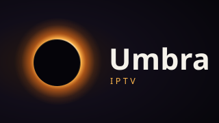
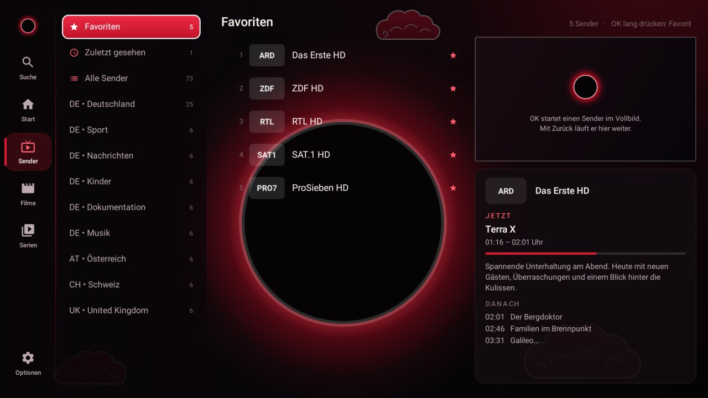
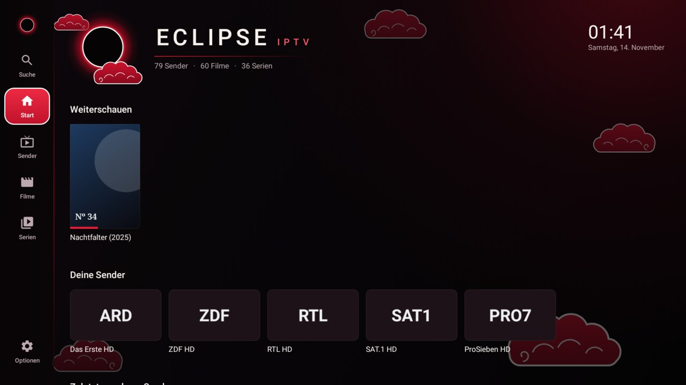
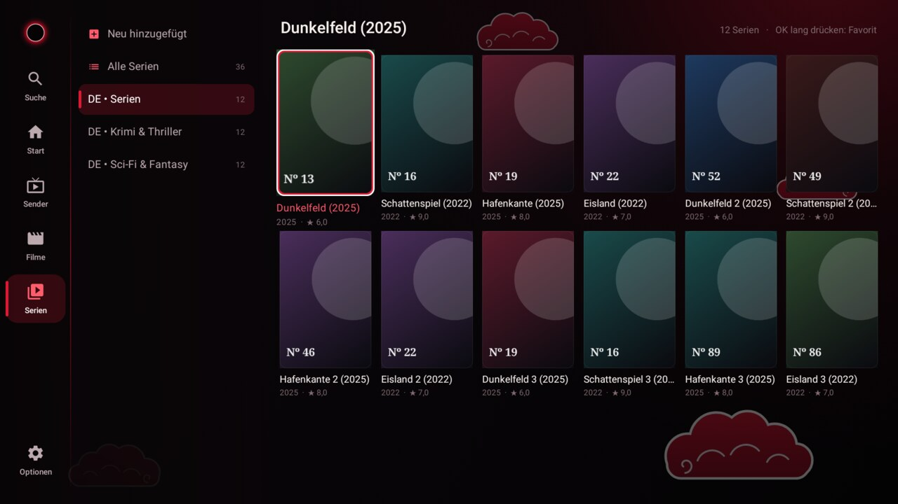
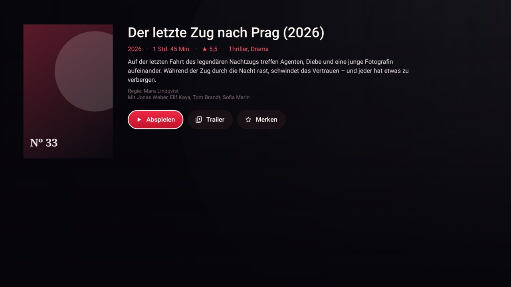

<div align="center">



# Eclipse IPTV

**IPTV für große Playlists.** Sender, Filme und Serien aus einer M3U-Playlist oder einem
Xtream-Zugang, übersichtlich sortiert und komplett mit der Fernbedienung bedienbar.

[](https://github.com/BradonjaDev/eclipse-iptv/releases/latest)
[](https://github.com/BradonjaDev/eclipse-iptv/actions/workflows/build.yml)
[](https://github.com/BradonjaDev/eclipse-iptv/releases/latest/download/eclipse-iptv.apk)


</div>

---

Eclipse IPTV ist aus [Oma TV](https://github.com/BradonjaDev/oma-tv) hervorgegangen. Oma TV zeigt
bewusst nur eine Handvoll Sender; Eclipse IPTV ist das Gegenstück für Playlists mit zehntausenden
Einträgen.

<p align="center">
  
  
  
  
</p>
<p align="center"><sub>Bildschirmfotos mit erfundenen Testdaten, automatisch erzeugt bei jedem Push.</sub></p>

## Was die App kann

- **Große Playlists:** zehntausende Sender, Filme und Serien werden in eine lokale Datenbank eingelesen und sind danach sofort durchsuchbar
- **Listen entstehen von selbst:** die Kategorien der Playlist werden übernommen, getrennt nach Sendern, Filmen und Serien
- **Xtream-Zugänge werden erkannt:** aus einem Link der Form `…/get.php?username=…&password=…` holt die App zusätzlich Beschreibungen, Besetzung, Bewertungen, Trailer und das laufende Programm
- **Vorschau neben der Senderliste:** Zurück aus dem Vollbild läuft der Sender klein weiter, ohne neu zu laden – über dieselbe Verbindung, auch bei Zugängen mit nur einer erlaubten Verbindung. Das Video geht direkt an die Grafik-Hardware (SurfaceView) und bleibt flüssig, egal was in der Liste passiert
- **Programm zum Sender:** was läuft gerade, wie lange noch, was kommt danach
- **Filme und Serien mit Detailseite:** Poster, Handlung, Trailer (über die YouTube-App), Staffeln und Folgen
- **Weiterschauen:** die App merkt sich, wo du aufgehört hast, und spielt bei Serien die nächste Folge
- **Favoriten, „Zuletzt gesehen“ und Suche** über alles
- **Player:** Umschalten mit ▲▼, Senderliste auf OK, Zifferneingabe, Tonspur, Untertitel und Bildformat; spielt auch AC3, E-AC3 und DTS
- **Jugendschutz:** Inhalte ab 18 sind standardmäßig ausgeblendet; einzelne Kategorien lassen sich verbergen
- **Einrichtung vom Handy:** QR-Code scannen, Link einfügen, fertig
- **Design:** Schwarz, Blutmond-Rot und weiße Konturen, langsam treibende rote Wolken; die Auswahl ist eine kräftig rote Fläche mit weißem Rand und auch vom Sofa aus gut zu erkennen
- **Sparsam:** Wolken werden einmal gezeichnet und nur verschoben, der Hintergrund ist vorberechnet, und alle Animationen stehen still, solange sie nicht zu sehen sind
- Kein Konto, keine Werbung, keine Datensammlung

## Installieren

Die aktuelle Version liegt immer hier:

```
https://github.com/BradonjaDev/eclipse-iptv/releases/latest/download/eclipse-iptv.apk
```

Auf dem TV-Stick am einfachsten mit der App **Downloader**: Adresse eintippen, installieren, fertig.
Ältere Versionen und die Änderungen stehen unter [Releases](https://github.com/BradonjaDev/eclipse-iptv/releases).

## Einrichten

Beim ersten Start zeigt Eclipse IPTV einen QR-Code und eine Adresse wie `192.168.178.50:8080`.

1. Handy ins selbe WLAN bringen, QR-Code scannen oder die Adresse im Browser öffnen.
2. M3U-Link einfügen oder die Xtream-Zugangsdaten eintragen und auf **Playlist laden** tippen.
3. Der Fernseher lädt die Playlist und wechselt danach von selbst zur Startseite.

Wer eine Tastatur am Gerät hat, kann den Link über **Am Gerät eingeben** auch direkt eintippen.
Weitere Playlists lassen sich später unter **Optionen → Playlists verwalten** hinzufügen.

## Bedienung

| Wo | Taste | Was passiert |
|---|---|---|
| Listen | ◀ ▶ ▲ ▼, OK | bewegen und öffnen |
| Listen | OK lang auf einem Eintrag | Favorit setzen oder entfernen |
| Listen | OK lang auf einer Kategorie | Kategorie ausblenden |
| Überall | Zurück | eine Ebene zurück, auf der Startseite zweimal zum Beenden |
| Vollbild | Zurück | zurück zur Liste, der Sender läuft in der Vorschau weiter |
| Senderliste | ◀ | zurück zu den Kategorien, noch einmal ◀ zur Leiste |
| Sender | ▲ / ▼ oder P+ / P− | nächster / vorheriger Sender |
| Sender | OK | Senderliste |
| Sender | ◀ | zurück zum vorherigen Sender |
| Sender | ▶ | Einblendung mit Programm |
| Sender | Ziffern | Sender direkt wählen |
| Film | OK | Pause / weiter |
| Film | ◀ ▶ | spulen (gedrückt halten: schneller) |
| Film | ▼ | Tonspur, Untertitel, Bildformat, nächste Folge |
| Player | OK lang oder Menü | Optionen |

## Selbst bauen

Es ist kein Android Studio nötig. GitHub Actions baut die APK bei jedem Push und jedem Pull Request.

**Neue Version veröffentlichen:** in `app/build.gradle` `versionCode` um 1 und `versionName`
erhöhen und auf `main` pushen. Der Workflow setzt dann den Tag `v<version>` genau auf diesen
Commit und erstellt den Release mit `eclipse-iptv.apk`. Pushes ohne neue Versionsnummer werden nur gebaut.

Lokal geht es mit JDK 17 und dem Android SDK so:

```
./gradlew assembleRelease
```

Ohne Signaturschlüssel wird die APK mit dem Debug-Schlüssel signiert. Der echte Schlüssel
liegt in den GitHub-Secrets `ECLIPSE_KEYSTORE_BASE64` und `ECLIPSE_KEYSTORE_PASSWORD`.

`tools/check.sh` prüft den Code in wenigen Sekunden ohne Android SDK (nur Typprüfung, keine APK).

**Bildschirmfotos:** Der Workflow „Screenshots“ startet die App bei jedem Push ohne Gerät
(Robolectric) mit einem kleinen Test-Server voller erfundener Sender, Filme und Serien, bedient
sie mit den Pfeiltasten und legt die Bilder als Artefakt `screenshots` ab
(`app/src/test/java/de/eclipseiptv/shots`). Logo und Banner entstehen aus `tools/art/gen.py`.

## Aufbau

| Paket / Datei | Aufgabe |
|---|---|
| `data/Importer`, `M3u`, `Xtream`, `Json` | Playlist einlesen: M3U zeilenweise, Xtream über die Schnittstelle, alles im Datenstrom |
| `data/Db` | SQLite: Quellen, Kategorien, Einträge, Folgen, Favoriten und Abspielpositionen |
| `data/Sync`, `Epg` | Einlesen im Hintergrund, Programminfos mit Zwischenspeicher |
| `MainActivity` | Leiste links und die Bereiche Suche, Start, Sender, Filme, Serien, Optionen |
| `ui/BrowseView`, `HomeView`, `SearchView`, `SettingsView` | die Bereiche |
| `ui/TvRecycler`, `Cards`, `Sheet`, `Ui` | Listen für die Fernbedienung, Karten, Auswahlfenster, Farben und Maße |
| `ui/LivePlayer`, `LivePreview` | der gemeinsame Sender-Player und die Vorschau neben der Senderliste |
| `ui/Clouds`, `EclipseView` | Wolken und Finsternis |
| `DetailActivity` | Film- und Serienseite |
| `PlayerActivity` | Player (Media3/ExoPlayer) |
| `SetupActivity`, `SetupServer` | Einrichtung, kleiner Webserver für das Handy |

Java ohne Kotlin, Oberfläche komplett im Code, Media3/ExoPlayer 1.9, ab Android 7.0 (API 24).

## Gut zu wissen

- Eclipse IPTV bringt **keine Inhalte mit** und ist an keinen Anbieter gebunden. Verwende nur Playlists, deren Inhalte du nutzen darfst. Frei zugängliche Sender sammelt zum Beispiel [iptv-org/iptv](https://github.com/iptv-org/iptv).
- Zugangsdaten bleiben auf dem Gerät. Sie werden nur an den Server der eingetragenen Playlist geschickt.
- Die Einrichtungsseite ist nur erreichbar, solange der Einrichtungsbildschirm offen ist.
